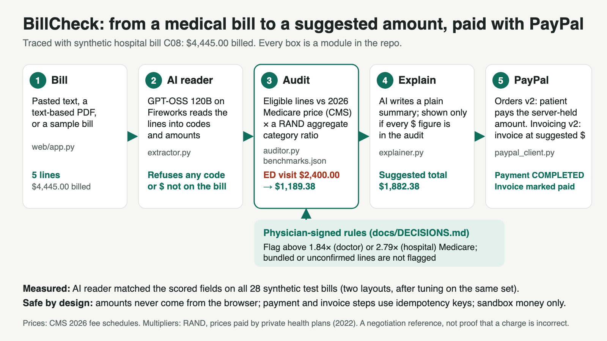

# BillCheck

**Reads a US medical bill, compares each eligible line with its 2026 Medicare price, explains the gaps in plain words (and says when no benchmark is available), and lets the patient pay a suggested amount through PayPal. BillCheck then generates an itemized invoice at the suggested amounts from the provider's PayPal sandbox merchant account and marks it paid with that same payment.**

PayPal AI Hackathon 2026 entry. Synthetic bills and PayPal sandbox money only.



## Why

Hospital list prices ("chargemaster" charges) can sit far above what hospitals are actually paid: a national study found an average charge-to-cost ratio of 3.4 in 2012 (Bai & Anderson, *Health Affairs* 2015, PMID 26056196), and the same study notes that uninsured patients are commonly asked to pay full charges, while out-of-network patients are often expected to pay a large portion of them. A patient holding a bill has no easy way to see which lines sit far above a public reference, or to pay a suggested amount with a paper trail.

## What it does

1. **Bill in.** Paste the bill text, upload a text-based PDF, or pick one of five synthetic sample bills.
2. **AI reader** (`src/billcheck/extractor.py`). GPT-OSS 120B on Fireworks turns the bill into line items (code, modifier, units, amount, date). The output is held to a fixed schema, and every code, modifier, amount and the date must appear on the bill itself, with each code on the same line as its amount. Anything else is refused.
3. **Audit** (`src/billcheck/auditor.py`, `src/billcheck/benchmarks.json`). Each eligible line is compared with its 2026 Medicare price: Physician Fee Schedule for doctor and radiologist lines, hospital outpatient (OPPS) rates for hospital lines, the lab fee schedule for lab-only bills. A line is flagged when it is above what private health plans paid on average relative to Medicare in RAND's Round 5.1 study (2022 data): 1.84× for professional services, 2.79× for outpatient hospital services. The suggested amount is that reference, capped at the billed amount. Lines that Medicare bundles into another payment, or whose separate price could not be confirmed, are not flagged. The rules were signed by a physician and are in [`docs/DECISIONS.md`](docs/DECISIONS.md).
4. **Explain** (`src/billcheck/explainer.py`). The model writes a short plain-language summary. It is shown only if every dollar figure in it appears in the audit and it contains no link, contact detail, markup or wording that the signed rules exclude. Otherwise a fixed template is shown.
5. **Pay with PayPal** (`src/billcheck/paypal_client.py`, `src/billcheck/web/app.py`).
   - **Orders v2:** the patient pays the suggested total. The amount is held on the server; the browser never sends it.
   - **Invoicing v2:** after the capture, BillCheck generates an itemized invoice at the suggested amounts from the provider's PayPal sandbox merchant account, sends it to the payer's email and records the captured payment on it, so it shows as paid.

6. **Audit history in AG Grid** (`src/billcheck/web/static/history.js`). Every bill checked in the browser, one row per line, in [AG Grid Community](https://www.ag-grid.com/) (MIT, version 36.2.0, served from this app and pinned by hash in the tests): billed amount, 2026 Medicare price, suggested amount and difference per line, the status badge with the line's explanation on hover, and each bill's PayPal payment state. Sort or filter any column, search all lines at once, and export to CSV for a billing office or patient advocate; the totals row follows the filter (for example, all lines above the reference across several bills). "Check all 5 sample bills" fills it in one click. The server returns only the audits whose ids the browser sends, in the request body; there is no endpoint that lists all audits.

Example, synthetic hospital bill C08: $4,445.00 billed. The ED visit ($2,400.00) is compared with the 2026 OPPS rate of $426.30 and suggested at $1,189.38; the CT head ($1,650.00) at $298.00. The routine labs would usually be included in other payments on this bill, and the injection has no confirmed separate benchmark, so neither is flagged. Suggested total: **$1,882.38**.

> A flag is a negotiation reference based on public prices, not proof that a charge is incorrect.

## How PayPal is used

| PayPal API | What BillCheck does with it |
|---|---|
| JavaScript SDK (sandbox) | PayPal and card buttons for the suggested amount |
| Orders v2 | Create the order for the server-held amount; capture after approval; check the captured amount matches the audit |
| Invoicing v2 | Create and send the BillCheck-generated invoice at the suggested amounts; record the captured payment on it |

The server keeps one order per audit and checks each step's state, and the capture, invoice and payment-record calls carry idempotency keys. These are designed to prevent duplicate charges and invoices; in the stress test a 9-way double click produced one order.

## Measured results

All numbers below come from scripts in this repo; each linked file explains how it was produced and its limits.

- **AI reader** ([`docs/G1.md`](docs/G1.md)): after tuning on the same synthetic test set, the final run matched the scored extraction fields on all 28 bills rendered in our two layouts; this does not estimate accuracy on real bills.
- **Rules** (`tests/`): 14 signed synthetic bills with expected results (`data/cases.json`) plus edge cases; 155 tests pass, and CI runs them on every pull request.
- **Stress** ([`docs/STRESS.md`](docs/STRESS.md)): 22/22 checks, including 6 AI audits at once, 200 requests at 50-way concurrency, a 9-way double click giving one order, 13 invalid-input and route checks answered with the expected 4xx responses, a prompt-injection test that returned the expected $1,882.38 total, and rate limits that a forged `X-Forwarded-For` cannot bypass.
- **Live sandbox** ([`docs/LIVE_CHECK.md`](docs/LIVE_CHECK.md)): bill C08 paid with PayPal's published sandbox test card; PayPal reports the capture COMPLETED for $1,882.38 and the BillCheck-generated invoice MARKED_AS_PAID for $1,882.38.

## Run it

Requires Python 3.11+, a PayPal **sandbox** REST app (US business account, with the Invoicing feature on) and a Fireworks API key.

```bash
git clone https://github.com/DrAhmed7887/hack-paypal-ai.git
cd hack-paypal-ai
python3 -m venv .venv && source .venv/bin/activate
pip install -e '.[dev]'
python -m pytest -q
export PAYPAL_CLIENT_ID=... PAYPAL_CLIENT_SECRET=... FIREWORKS_API_KEY=...   # names and optional settings: .env.example
uvicorn billcheck.web.app:app --no-proxy-headers
```

Open http://127.0.0.1:8000, pick a sample bill, and pay with a PayPal sandbox buyer account or a [PayPal sandbox test card](https://developer.paypal.com/tools/sandbox/card-testing/). On macOS, `scripts/serve.sh` reads the three keys from the Keychain instead of the environment. Model spend is capped at $2 per day in code (`BILLCHECK_DAILY_CAP_USD`).

## AI tools used

- **In the product:** GPT-OSS 120B on Fireworks AI reads bills into line items and writes the plain-language summary. Both outputs are checked by code before use.
- **To build it:** Claude Code (Anthropic) wrote and tested the code under the physician's direction. GitHub Copilot reviewed the pull requests, and separate AI reviewer agents also checked code and security changes (the pull requests and full commit history are in the private development repository; this public repository starts from one clean commit). GPT-6 Sol (RWTH university AI service) acted as an independent quality checker for the rules, test expectations and measured results ([`docs/QA.md`](docs/QA.md)).

## Data and sources

- All bills are synthetic ([`data/DATA_CARD.md`](data/DATA_CARD.md)). No real patients, providers or bills.
- Medicare prices: CMS 2026 Physician Fee Schedule (`indicators2026-09-01`), Clinical Laboratory Fee Schedule (2026 Q4), OPPS Addendum B (October 2026), and the CY 2026 OPPS/ASC final rule for packaging.
- Reference multipliers: Whaley et al., *Prices Paid to Hospitals by Private Health Plans: Findings from Round 5.1*, RAND RR-A1144-2-v2 (2024).

Not medical, legal or financial advice. Prices are national and not adjusted for locality.

## License

MIT, see [`LICENSE`](LICENSE).
